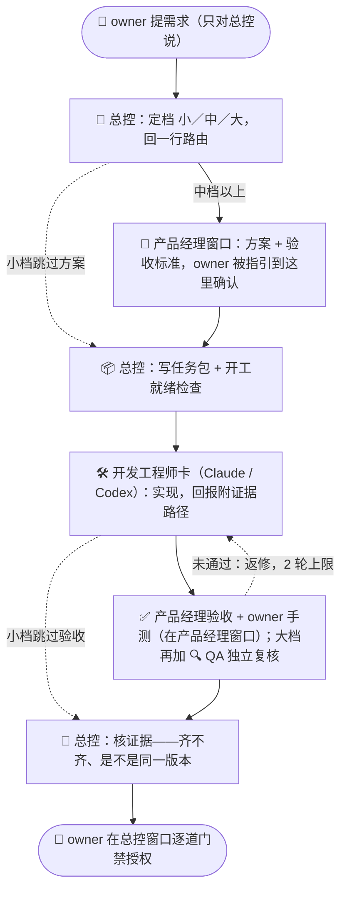

<div align="center">

# 一人 AI 团队协作手册

**一个人，带一支 AI 团队。**<br>
同时开多个 AI 会话推进同一个项目时——谁说了算、什么算完成、什么需要你授权。


[30 秒看懂](#30-秒看懂) · [主线流程](#主线流程) · [六个亮点](#六个亮点) · [和同类方案的区别](#和同类方案的区别) · [快速开始](#快速开始)

</div>

---

## 30 秒看懂

| 场景 | 没有这套 | 用了这套 |
|---|---|---|
| 提需求 | 你在 N 个窗口之间来回转述 | 只对总控说，它先回你一行路由 |
| 找人 | 窗口一多，不知道该在哪个窗口说话 | `★` 是总控，`↳` 不用理，`💬` 是总控请你去定事的窗口 |
| 定方案 | 总控把方案转述一遍，你看不到依据、没法追问 | 总控只告诉你去哪个窗口、定几项，你在产品经理窗口边看边定 |
| 并行 | 总控做一件，其他事干等 | 任务池 + 4 个调度时点，能并行就并行，改同一批文件的自动排先后 |
| 状态 | 各窗口各写一份，互相覆盖；换个总控就换个样子 | 一份状态文件、一张固定看板，说“看板”随时出 |
| 大任务 | 一个任务要开好几个窗口，总控被撑满 | 设子总控 `◆` 管任务内部，项目总控只看一行 |
| 完成 | AI 说“做完了”就算完 | 回报附证据路径，核对是不是同一版本 |
| 授权 | 一句“可以”被当成推送许可 | 合并、推送、发布逐道用明确话术授权 |
| 换窗口 | 上下文爆了，从头再讲一遍 | 50% 做完手头这件就换、70% 立即交接，新窗口读文件接力 |

## 主线流程



> 实线是中档主线，虚线是小档捷径和返修回环。总控不自己出方案、不评审手测，要你看材料才能定的事，它只给你指路。一个完整的例子见 [examples/walkthrough-medium.md](examples/walkthrough-medium.md)。

## 六个亮点

| | 亮点 | 一句话 |
|---|---|---|
| 🎯 | **单一入口** | 你默认只跟一个总控说话，要你定的事它告诉你去哪个窗口，窗口再多也不用当传话筒 |
| 🃏 | **职能是卡，不是窗口** | 需求分析、产品、开发、QA 写成岗位卡，按阶段装载，不为凑角色开窗 |
| 📏 | **小／中／大分档** | 小事一行路由就开工，大事才走全流程和独立复核 |
| 📦 | **自含任务包** | 施工方只认任务包文件，聊天里的口头指令不作数 |
| 🔍 | **证据分层** | 自测、复核、核证据、手测各证明一层，没看过就写“未验证” |
| 🚦 | **门禁话术** | “可以／好的”不算授权，不可逆动作逐道单独确认 |

每条规则都写了“不这样会怎样”，见 `PLAYBOOK.md` 第 1 节和附录 D。

## 和同类方案的区别

| | 本手册 | Spec Kit / BMAD | CCPM | Claude Code agent teams |
|---|---|---|---|---|
| 侧重 | **治理**：谁说了算、什么算完成、什么要授权 | 规格驱动：规格 → 计划 → 任务 | 用 GitHub Issues 驱动并行开发 | 多个 Claude 会话自动协作 |
| 形态 | 纯 Markdown，`CLAUDE.md` 里一行导入就能用 | CLI + 斜杠命令 | 命令 + GitHub Issues | Claude Code 实验功能 |
| 混用多家 AI | ✅ | ✅ | ✅ | 仅 Claude |
| 授权门禁 | 核心内容 | 不是重点 | 不是重点 | 靠权限规则和 hook |

它们管“怎么做出来”，本手册管“谁说了算”，**可以叠加使用**，对应关系见 `PLAYBOOK.md` 第 9 节。

## 快速开始

```bash
git clone https://github.com/rainman016/solo-ai-team-playbook.git ~/.claude/solo-ai-team-playbook
```

1. **先看示例**：花 5 分钟读 [examples/walkthrough-medium.md](examples/walkthrough-medium.md)，了解整套流转长什么样。
2. **装通用规则**：在全局 `~/.claude/CLAUDE.md` 加一行 `@~/.claude/solo-ai-team-playbook/CLAUDE-snippet.md`，所有窗口都会加载。规则里的路径都按上面的克隆位置写；装在别处的，把路径前缀统一替换掉。
3. **开总控台**：在项目里建 `总控台/` 子文件夹，把 [templates/lead-desk-CLAUDE.md](templates/lead-desk-CLAUDE.md) 复制成它的 `CLAUDE.md`，总控固定在这里开窗（首次开窗弹出外部导入确认时点允许）。再让总控按 `PLAYBOOK.md` 第 8 节搭最小起步：项目根 `AGENTS.md`（`CLAUDE.md` 只写 `@AGENTS.md`）、状态文件、任务包和回报的位置。
4. **只对总控说**：总控接单时会先回一行“→ 档位／岗位卡／执行者，原因”，不对就当场叫停。
5. **以后更新**：`git pull` 之后看 [CHANGELOG.md](CHANGELOG.md)，让各项目总控对照项目规则，把冲突和新增条款交你确认。

## 文件

| 文件 | 内容 |
|---|---|
| [CLAUDE-snippet.md](CLAUDE-snippet.md) | 通用规则：所有窗口常驻，十条左右，由全局 `CLAUDE.md` 导入 |
| [rules/lead.md](rules/lead.md) | 总控专用规则（项目总控和子总控读）：路由、子总控、派单、少打扰、任务池与运行资源、调度、找 owner 与协商、汇报、接力、规则更新 |
| [rules/sub-lead.md](rules/sub-lead.md) | 子总控规则（设了子总控才读）：设立、能做与不能做、向上报 |
| [rules/shared.md](rules/shared.md) | 共用规范：验收标准写法、回报格式、证据要求、协商记录、找 owner 的细则 |
| [roles/](roles/) | 四张岗位卡：需求分析师、产品经理、开发工程师、质量评审 |
| [PLAYBOOK.md](PLAYBOOK.md) | 原理与推荐做法：原则、角色、流转、路由、为什么这样定、与现有工具的配合 |
| [examples/walkthrough-medium.md](examples/walkthrough-medium.md) | 端到端示例：一件中档需求从提出到收口，附小档对照 |
| [templates/](templates/) | 看板、状态文件、任务包、回报、总控台 `CLAUDE.md` 模板（含决策记录、文档上限、新项目起步、可选的总控台权限配置） |
| [optional/](optional/) | **可选**机器兜底（仅 Claude 桌面端）：派单钩子、总控台写入守卫、门禁确认弹框、巡检（试点），装法见其 README |
| [skills/relay/](skills/relay/SKILL.md) | 跨账号接力技能 |
| [衔接脚手架.md](衔接脚手架.md) | 与 AI 协同开发脚手架的衔接表、门禁清单写法、改动时要通知的位置 |
| [CHANGELOG.md](CHANGELOG.md) | 版本记录：每条新条款和原来的做法 |

<details>
<summary><b>术语表</b>（点击展开）</summary>

| 术语 | 含义 |
|---|---|
| owner | 项目发起人：提需求、拍板、手测验收、对门禁签字的那个人 |
| 技术负责人（总控） | 唯一对接 owner 的窗口，负责定档、拆任务、写任务包、派单、排程、核证据 |
| 岗位卡 | 一张一屏的职责说明（需求分析师、产品经理、开发工程师、QA）；职能是卡，不是窗口 |
| 执行者 | 装载岗位卡干活的窗口或子代理，一个执行者可先后装载多张卡 |
| 任务包 | 施工方拿到就能做、不必回头查的自含指令文件 |
| 门禁 | 合并、推送、发布、部署等不可逆动作，每道单独授权，只在总控窗口给 |
| 总控台 | 项目里的 `总控台/` 子文件夹，总控在这里开窗，自动加载总控专用规则 |

</details>

## 与脚手架 v2.x 衔接

写代码项目时，可以和 [AI 协同开发脚手架](https://github.com/rainman016/ai-collab-dev-scaffold)（仓库 `rainman016/ai-collab-dev-scaffold`）一起用：本手册管窗口之间怎么派单、回报、通知，脚手架管每个窗口里的代码怎么施工、验证、过门禁。两边的对应关系见 [衔接脚手架.md](衔接脚手架.md)。

## 适用与不适用

- ✅ **适用**：一个 owner + 2 个以上 AI 会话推进同一项目；同一种 AI 多开或多家 AI 混用都行；内容型项目、代码项目都行。
- ❌ **不适用**：单个窗口就能做完的小事——直接做，不需要这套流程。

## 现状与局限

- 提炼自内容型项目和功能型代码项目的真实多窗口协作实践。
- 第二版新增部分（岗位卡、规模分档、阶段路由、资源压力）经过两轮独立复核，但**尚未在真实多线任务中完整试运行**；v2.1 的并行调度和入口标记，来自真实项目里“接力后没有并行”“分不清该在哪个窗口说话”的教训。
- v2.2 来自两个真实项目的检验：总控转问需求把自己的上下文撑满、owner 没法边看依据边定；长期开着的总控窗口被聊天撑到自动压缩；跨账号的通知送不到，一条线停摆没人发现。改动经多轮独立复核，并实测了总控台子文件夹的加载方式。
- v2.3 来自第三个项目（总控跑在 Codex 上）的检验：转交只做到“消息送到”没人接、总控插话过细、共用机器上运行撞车、owner 要跨窗口拼进度。新增子总控、固定看板、【已接】回执、运行资源登记、授权分层，经 7 轮独立复核；还没在真实多线任务里完整跑过。
- v2.8–v3.0 来自继续试跑与复核：手测清单模板、任务池逐项列明细、规则正本改 `AGENTS.md`、产品经理卡加真实数据试跑、Codex 派单先读卡、可选巡检少误报；改动经独立复核，可选脚本跑过自带测试，线上钩子环境未全面实测。
- v2.4–v2.7 来自真实项目的试跑与检验：精简常驻规则（按字数预算）、文档治理、派单定档（贵／中／便宜三档）、窗口标题由总控管。`optional/` 里的机器兜底和巡检是可选的，巡检仍是试点，部分能力未实测。
- 部分做法依赖 Claude Code 桌面端的能力（`SendMessage` 跨窗口发消息、`get_session` 查会话编号、查看上下文占比和额度），不支持时按“写文件 + owner 转达”降级。
- 示例以 Claude Code + Codex 为主，换成其他 AI 工具同样适用。

## 参考

- Anthropic：《Building effective agents》《How we built our multi-agent research system》
- Claude Code 文档：best practices、subagents、[agent teams](https://code.claude.com/docs/en/agent-teams)
- MetaGPT（按软件公司岗位分工的多智能体框架）
- [BMAD-METHOD](https://github.com/bmad-code-org/BMAD-METHOD)（按规模分档的 AI 敏捷开发方法）
- [GitHub Spec Kit](https://github.com/github/spec-kit)（规格驱动开发）
- [CCPM](https://github.com/automazeio/ccpm)（用 GitHub Issues 做状态源的多 agent 并行）

## 许可

[CC BY 4.0](LICENSE)：可自由转载、修改、商用，请注明出处。
