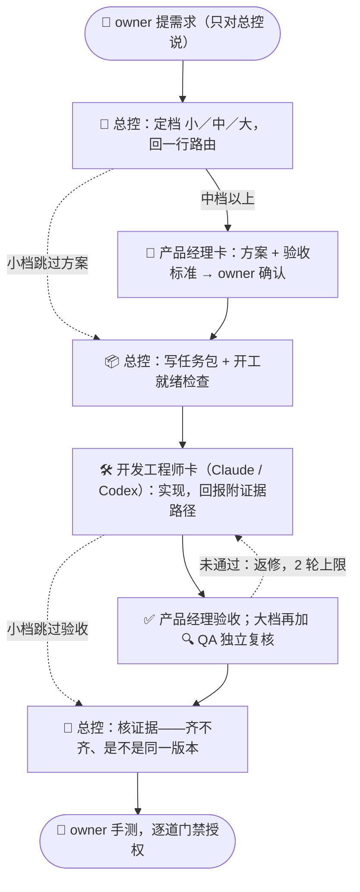

<div align="center">

# 一人 AI 团队协作手册

**一个人，带一支 AI 团队。**<br>
同时开多个 AI 会话推进同一个项目时——谁说了算、什么算完成、什么需要你授权。


[30 秒看懂](#30-秒看懂) · [主线流程](#主线流程) · [六个亮点](#六个亮点) · [和同类方案的区别](#和同类方案的区别) · [快速开始](#快速开始)

</div>

---

## 30 秒看懂

| 场景 | 没有这套 | 用了这套 |
|---|---|---|
| 提需求 | 你在 N 个窗口之间来回转述 | 只对总控说，它先回你一行路由 |
| 找人 | 窗口一多，不知道该在哪个窗口说话 | `★` 是总控，`↳` 不用理 |
| 并行 | 总控做一件，其他事干等 | 任务池 + 4 个调度时点，能并行就并行，改同一批文件的自动排先后 |
| 状态 | 各窗口各写一份，互相覆盖 | 一份状态文件，只有总控写 |
| 完成 | AI 说“做完了”就算完 | 回报附证据路径，核对是不是同一版本 |
| 授权 | 一句“可以”被当成推送许可 | 合并、推送、发布逐道用明确话术授权 |
| 换窗口 | 上下文爆了，从头再讲一遍 | 70% 主动交接，新窗口读文件接力 |

## 主线流程



> 实线是中档主线，虚线是小档捷径和返修回环。一个完整的例子见 [examples/walkthrough-medium.md](examples/walkthrough-medium.md)。

## 六个亮点

| | 亮点 | 一句话 |
|---|---|---|
| 🎯 | **单一入口** | 你只跟一个总控说话，窗口再多也不用当传话筒 |
| 🃏 | **职能是卡，不是窗口** | 需求分析、产品、开发、QA 写成岗位卡，按阶段装载，不为凑角色开窗 |
| 📏 | **小／中／大分档** | 小事一行路由就开工，大事才走全流程和独立复核 |
| 📦 | **自含任务包** | 施工方只认任务包文件，聊天里的口头指令不作数 |
| 🔍 | **证据分层** | 自测、复核、核证据、手测各证明一层，没看过就写“未验证” |
| 🚦 | **门禁话术** | “可以／好的”不算授权，不可逆动作逐道单独确认 |

每条规则都写了“不这样会怎样”，见 `PLAYBOOK.md` 第 1 节和附录 D。

## 和同类方案的区别

| | 本手册 | Spec Kit / BMAD | CCPM | Claude Code agent teams |
|---|---|---|---|---|
| 侧重 | **治理**：谁说了算、什么算完成、什么要授权 | 规格驱动：规格 → 计划 → 任务 | 用 GitHub Issues 驱动并行开发 | 多个 Claude 会话自动协作 |
| 形态 | 纯 Markdown，贴进 `CLAUDE.md` 就能用 | CLI + 斜杠命令 | 命令 + GitHub Issues | Claude Code 实验功能 |
| 混用多家 AI | ✅ | ✅ | ✅ | 仅 Claude |
| 授权门禁 | 核心内容 | 不是重点 | 不是重点 | 靠权限规则和 hook |

它们管“怎么做出来”，本手册管“谁说了算”，**可以叠加使用**，对应关系见 `PLAYBOOK.md` 第 11 节。

## 快速开始

```bash
git clone https://github.com/rainman016/solo-ai-team-playbook.git
```

1. **先看示例**：花 5 分钟读 [examples/walkthrough-medium.md](examples/walkthrough-medium.md)，了解整套流转长什么样。
2. **装规则**：把 [CLAUDE-snippet.md](CLAUDE-snippet.md) 贴进项目根 `CLAUDE.md`（或全局 `~/.claude/CLAUDE.md`），把“完整版见”的路径改成 `PLAYBOOK.md` 的实际位置。
3. **开总控**：开一个总控窗口，让它按 `PLAYBOOK.md` 第 10 节搭最小起步：状态文件、任务包和回报的位置、本项目版岗位卡。
4. **只对总控说**：总控接单时会先回一行“→ 档位／岗位卡／执行者，原因”，不对就当场叫停。

## 文件

| 文件 | 内容 |
|---|---|
| [PLAYBOOK.md](PLAYBOOK.md) | 完整方法论：原则、角色、流转、路由、并行、资源压力、文档纪律、与现有工具的配合、岗位卡、规则理由 |
| [examples/walkthrough-medium.md](examples/walkthrough-medium.md) | 端到端示例：一件中档需求从提出到收口，附小档对照 |
| [CLAUDE-snippet.md](CLAUDE-snippet.md) | 十几条的摘要，可直接贴进 `CLAUDE.md` 或 `AGENTS.md` |
| [templates/](templates/) | 任务包、回报、项目状态文件三个模板 |

<details>
<summary><b>术语表</b>（点击展开）</summary>

| 术语 | 含义 |
|---|---|
| owner | 项目发起人：提需求、拍板、手测验收、对门禁签字的那个人 |
| 技术负责人（总控） | 唯一对接 owner 的窗口，负责定档、拆任务、写任务包、派单、排程、核证据 |
| 岗位卡 | 一张一屏的职责说明（需求分析师、产品经理、开发工程师、QA）；职能是卡，不是窗口 |
| 执行者 | 装载岗位卡干活的窗口或子代理，一个执行者可先后装载多张卡 |
| 任务包 | 施工方拿到就能做、不必回头查的自含指令文件 |
| 门禁 | 合并、推送、发布、部署等不可逆动作，每道单独授权 |

</details>

## 适用与不适用

- ✅ **适用**：一个 owner + 2 个以上 AI 会话推进同一项目；同一种 AI 多开或多家 AI 混用都行；内容型项目、代码项目都行。
- ❌ **不适用**：单个窗口就能做完的小事——直接做，不需要这套流程。

## 现状与局限

- 提炼自内容型项目和功能型代码项目的真实多窗口协作实践。
- 第二版新增部分（岗位卡、规模分档、阶段路由、资源压力）经过两轮独立复核，但**尚未在真实多线任务中完整试运行**；v2.1 的并行调度和入口标记，来自真实项目里“接力后没有并行”“分不清该在哪个窗口说话”的教训。
- 部分做法依赖工具能力（窗口间互发消息、查看上下文占比和额度），不支持时按“写文件 + owner 转达”降级。
- 示例以 Claude Code + Codex 为主，换成其他 AI 工具同样适用。

## 参考

- Anthropic：《Building effective agents》《How we built our multi-agent research system》
- Claude Code 文档：best practices、subagents、[agent teams](https://code.claude.com/docs/en/agent-teams)
- MetaGPT（按软件公司岗位分工的多智能体框架）
- [BMAD-METHOD](https://github.com/bmad-code-org/BMAD-METHOD)（按规模分档的 AI 敏捷开发方法）
- [GitHub Spec Kit](https://github.com/github/spec-kit)（规格驱动开发）
- [CCPM](https://github.com/automazeio/ccpm)（用 GitHub Issues 做状态源的多 agent 并行）

## 许可

[CC BY 4.0](LICENSE)：可自由转载、修改、商用，请注明出处。
